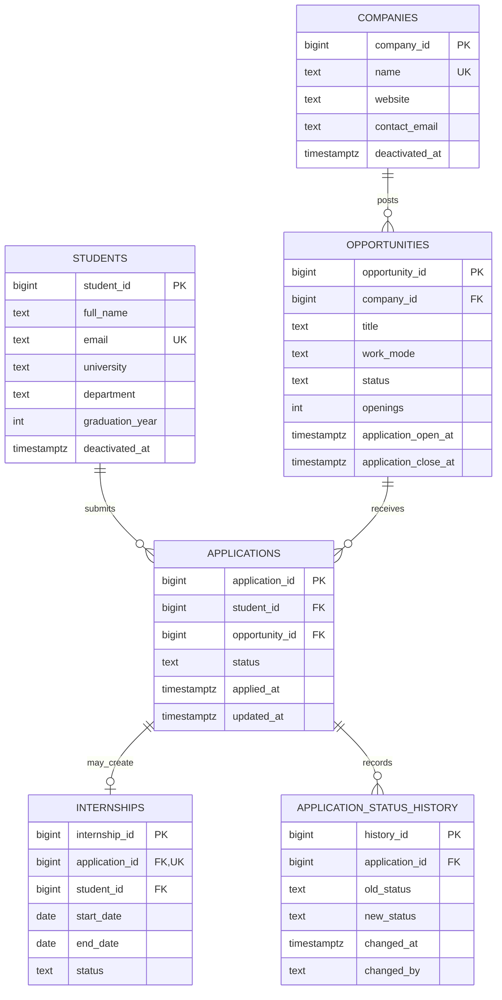

# Database Design Report — Internship Management

## 1. Scope and assumptions

The screenshot identifies the required outputs but does not include the original narrative brief. This implementation therefore uses a clearly stated, representative internship-management domain:

- Students apply to internship opportunities posted by companies.
- Each opportunity has an application window and a status.
- Applications progress through a controlled review workflow.
- Only accepted applications can be converted into internship records.
- An application and its status history are retained for auditability.
- The database is PostgreSQL 14+ and enforces the rules at the database layer, not only in application code.

The names, dates, and records in `fixtures/001_seed_data.sql` are test data, not real people or companies.

## 2. Conceptual ER model

### Relationship cardinalities

- One company can post zero or many opportunities; every opportunity belongs to exactly one company.
- One student can submit zero or many applications; every application belongs to exactly one student.
- One opportunity can receive zero or many applications; every application targets exactly one opportunity.
- An application can create zero or one internship. `UNIQUE(application_id)` enforces the “at most one” side.
- An application has one or more status-history rows after insertion, one for its initial status and another for every status change.

## 3. Rule-to-constraint matrix

| ID | Business rule | Enforcement | Expected failure |
|---|---|---|---|
| R1 | A student may apply to a specific opportunity only once. | `UNIQUE(student_id, opportunity_id)` on `applications`. | `23505` unique violation |
| R2 | New applications are accepted only when an opportunity is `open` and current time falls inside its application window. | `BEFORE INSERT` trigger `guard_application_write()`. | `23514` check/business-rule violation |
| R3 | An internship may only be created from an accepted application belonging to the same student. | Trigger `guard_internship_application()` plus composite FK `(application_id, student_id)`. | `23514` for non-accepted status; `23503` for missing/mismatched reference |
| R4 | A student may have at most one active internship at a time. | Partial unique index on `internships(student_id) WHERE status = 'active'`. | `23505` unique violation |
| R5 | An internship end date cannot precede its start date; active internships have no end date, completed/terminated internships must have one. | `CHECK` constraints `ck_internship_dates` and `ck_internship_status_dates`. | `23514` check violation |
| RI | Orphan references must be rejected and parent records with retained child records cannot be deleted. | Foreign keys, `ON DELETE RESTRICT`, and audit-history reference. | `23503` FK violation |
| WF | Application status follows an allowed workflow. | Trigger state machine: `submitted → under_review/withdrawn`; `under_review → accepted/rejected/withdrawn`; `accepted → withdrawn` only before internship creation. | `23514` business-rule violation |
| AUD | Every initial application status and subsequent status change is retained. | `AFTER INSERT OR UPDATE OF status` history trigger; history rows are append-only. | Audit record written transactionally; history updates/deletes rejected |

## 4. Relational schema and key decisions

- **Primary keys:** identity-backed integer keys are used for stable internal identifiers.
- **Candidate/alternate key:** student email is unique case-insensitively through a unique index on `lower(email)`; company name is unique.
- **Foreign keys:** every application refers to a student and opportunity. Every opportunity refers to a company. An internship references `(application_id, student_id)` together, preventing it from being assigned to a different student than the application.
- **Derived multi-column key:** `UNIQUE(student_id, opportunity_id)` ensures one application per student/opportunity pair.
- **Temporal constraints:** application windows have `close_at > open_at`; internship date and status/date combinations are check-constrained.
- **Indexes:** lookup indexes support opportunity status/window filtering, application queues, student application history, active internship uniqueness, and status-audit retrieval.
- **No cascade deletes:** related rows use `ON DELETE RESTRICT`; opportunities can be closed and people/companies can be deactivated instead of deleting records used for audit.

## 5. Retention and audit policy

Application status history is append-only and is generated automatically in the same transaction as the application change. Application records cannot be physically deleted while their history exists because the history FK uses `ON DELETE RESTRICT`. Student and company rows have deactivation timestamps for lifecycle handling. Close an opportunity by changing its status to `closed`; do not delete it if it has applications. Production deployments should additionally configure backups and a business-approved retention period for personal data; this starter implementation deliberately does not invent a legal retention duration.

## 6. Negative-test design

`tests/negative_sql_tests.sql` runs invalid statements inside exception-safe test calls and checks the expected PostgreSQL SQLSTATE. The suite covers:

1. Duplicate application (R1).
2. Application to a closed opportunity (R2).
3. Internship from a non-accepted application (R3).
4. Second active internship for one student (R4).
5. End date earlier than start date (R5).
6. Application referencing a nonexistent student (referential integrity).

Each test reports a `PASS` notice only if the database rejects the statement with the expected error code. A test fails if the invalid statement succeeds or fails for a different SQLSTATE.

## 7. Scope limitations and production follow-ups

This is a compact internship-management model, not a full HR platform. It does not yet include interview scheduling, offer documents, mentors, evaluations, authentication, or row-level authorization. The database trigger protects application-time eligibility when an application is inserted or its opportunity is changed; a production system that permits administrative changes to an opportunity's status should also define whether closing an opportunity should affect already-submitted applications (this model intentionally leaves existing applications intact).

## 8. Test run evidence and repository handoff

The project owner ran the negative-test script locally using PostgreSQL 16.15 and shared console output showing six `PASS` notices with expected SQLSTATEs (`23505`, `23514`, `23514`, `23505`, `23514`, and `23503`) plus the expected row counts: 2 students, 2 companies, 3 opportunities, 3 applications, 1 internship, and 7 application-status-history rows. The transcript and PowerShell caveat are documented in [`test-results.md`](test-results.md). The separately captured process exit code was not supplied, so this report does not assert one.

GitHub workflow instructions are in [`github-setup.md`](github-setup.md), and a pre-submission review is available in [`submission-checklist.md`](submission-checklist.md). The diagram is also available in GitHub-renderable Mermaid Markdown at [`er-diagram.md`](er-diagram.md).
