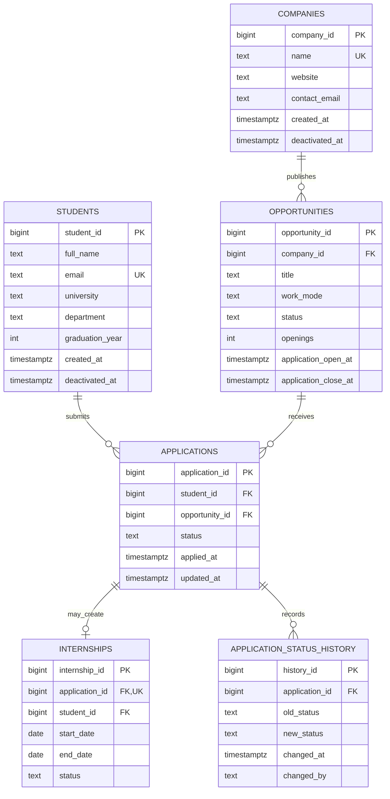

# Entity–Relationship Diagram

The diagram below shows the project tables and their conceptual relationships. GitHub renders Mermaid diagrams in Markdown.

For the relational rules and cardinality explanations, see [the design report](design.md).
